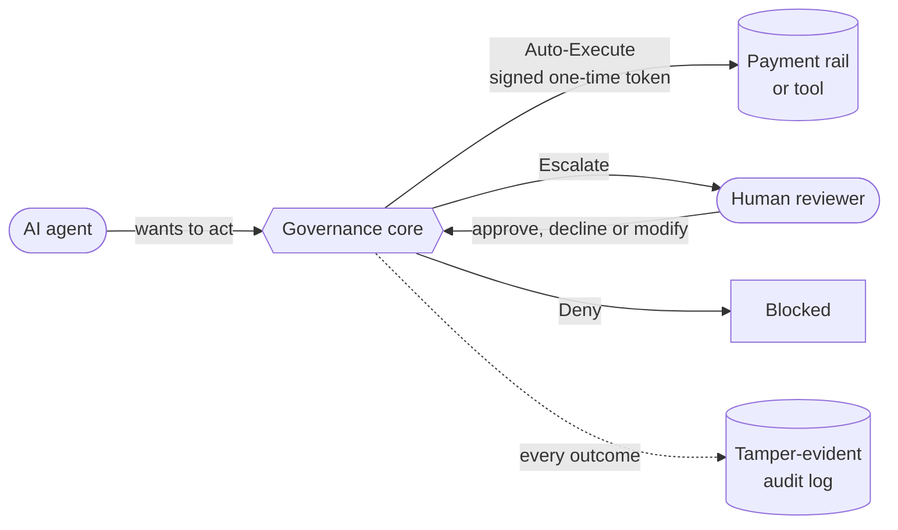
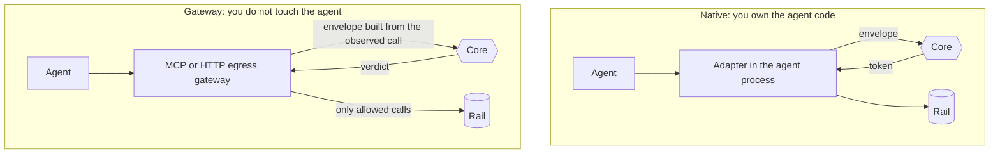

<p align="center">
  
</p>

# Agentic Runtime Governance

Let AI agents act in finance, and keep every action governed, explainable, and auditable. A readable, fully traceable reference showing how each condition of the SAFR white paper can be met at runtime, in working code you can run in minutes.

Based on *Safeguards for Agentic Finance at Runtime* (SAFR), v1.0, July 2026 (MAS / BuildFin.ai with industry contributors). This project implements the SAFR reference model.

> **Disclaimer.** Independent project. Not affiliated with or endorsed by MAS, BuildFin.ai, or any contributor. SAFR is not regulatory guidance, and nothing here is supervisory expectation. Demo only, not production-grade. All data is fictional ("Example Bank"). The paper is © MAS; this repo paraphrases it and cites by section name, with no copied text or figures.

## Why it exists

Agents that move money, open accounts, or message customers need more than a system prompt and good intentions. They need a runtime that decides, for every single action, whether it may proceed, must be escalated to a human, or must be stopped, and that can prove afterwards what happened and why.

This repo shows what that runtime looks like, piece by piece, with every behaviour tied to a requirement and every requirement tied to a test.

## The idea in one picture

Every action an agent wants to take passes through one decision core before it touches a bank rail. The core answers with one of three verdicts, and writes down why.



The agent never holds the keys to the rail. It holds, at most, a token that is good for exactly one action, once.

## Two ways to plug in

Pick the pattern that fits how much you control the agent. Both use the same core.



| | Sees the real call | Sees the reasoning | Needs agent changes |
|---|---|---|---|
| Native | Declared by the agent | Rich trace | Yes, a thin adapter |
| Gateway, standalone | Yes, authentic | Thin | No |
| Hybrid | Yes, and token must match it | Rich trace | Adapter plus gateway |

Hybrid is the strongest: the gateway only forwards a call if a native decision token matches it exactly, so bypassing the adapter does not work.

## What you get

- **Every action gets a verdict.** A deterministic disposition engine returns Auto-Execute, Escalate, or Deny. Probabilistic signals such as confidence and anomaly scores feed in from outside, so decisions stay reproducible.
- **Fail closed by design.** Errors, timeouts, and unreachable dependencies end in Deny or Escalate, never in a silent pass.
- **Agents with real identity and bounded authority.** Governance envelopes, agent identity, and mandates define who may do what, and under which controls.
- **Humans in the loop where it matters.** Built-in escalation routes risky actions to a reviewer and records the outcome.
- **An audit trail you can trust.** A hash-chained log with anchors makes tampering detectable. Decision tokens are signed with EdDSA.
- **Drop-in governance, no agent rewrite.** Wire it in natively through the docking point, or put an MCP or HTTP-egress gateway in front of existing agents, standalone or hybrid.
- **Swappable everywhere.** Stores, registries, and sinks are abstract contracts with shared test suites. The core has no web, framework, or cloud dependencies.
- **Proven, not promised.** A 26-scenario conformance suite and a generated requirement-to-test matrix show exactly which condition is satisfied where (`docs/conformance.md`).

## See it in action

```bash
uv sync --all-extras

uv run python demo/engine_demo.py   # the engine over sample envelopes, step by step
uv run python -m demo.e2e_demo      # full HTTP lifecycle: decisions, tokens, escalation, audit
uv run python -m demo.gateway_demo  # MCP gateway, standalone and hybrid, no agent code changes
```

Outputs below are real runs, trimmed for length. Everything is fictional ("Example Bank").

### 1. One engine, many verdicts

Same agent, same policy, different actions. The reason codes say which control decided.

```text
scenario                                     outcome             reasons
S01 payment 500, within limits               AUTO_EXECUTE        -
S02 payment 20,000 > per-action limit        ESCALATE            EXP_PER_ACTION_EXCEEDED, RISK_OBSERVE_THRESHOLD
S20 payment 10, low confidence               ESCALATE            EVD_CONFIDENCE_BELOW
S19 payment 100, rate window full            ESCALATE            RATE_EXCEEDED
S04 expired mandate                          DENY@mandate        MND_EXPIRED
S17 mandate widened by agent                 DENY@mandate        MND_SIGNATURE_INVALID
S05 suspended agent                          REJECTED@identity   IDN_AGENT_SUSPENDED
```

- A small payment inside limits runs on its own.
- An oversized payment, a shaky model, or a busy rate window goes to a human.
- An expired or self-widened mandate is denied outright, before any exposure check.
- A suspended or unknown agent is rejected at the identity stage and never reaches the engine.

### 2. Approved actions carry a one-time token

An Auto-Execute decision returns a signed token bound to the exact action. The payment rail redeems it and refuses anything else.

```text
payment       500 -> AUTO_EXECUTE -
rail redeems token (altered amount) -> 403 TOK_ACTION_MISMATCH
rail redeems token (exact action)   -> 200 ok
rail redeems token (second use)     -> 409 TOK_REPLAYED
```

An agent cannot change the amount after approval, and cannot reuse an approval.

### 3. Humans decide, with limits of their own

```text
payment    20,000 -> ESCALATE     EXP_PER_ACTION_EXCEEDED, RISK_OBSERVE_THRESHOLD
intern (limit 100) tries to approve -> 403 ESC_AUTHORITY_EXCEEDED
rita.reviewer approves              -> 200 state=APPROVED
modified to 400 -> child decision AUTO_EXECUTE (treasury-agent-1#7)
```

Reviewers have their own authority ceilings. A modified action re-enters the full pipeline with a link to its parent, so a reviewer cannot bypass the controls. Unreviewed escalations time out into a block.

### 4. Small payments add up

```text
payment     9,000 -> OBSERVE      RISK_OBSERVE_THRESHOLD
payment     9,000 -> OBSERVE      RISK_OBSERVE_THRESHOLD
payment     9,000 -> ESCALATE     EXP_AGGREGATE_EXCEEDED, RISK_OBSERVE_THRESHOLD
```

Each payment is fine alone. The third crosses the hourly aggregate limit for the principal.

### 5. A tamper-evident audit trail

```text
verify -> ok=True entries=16
anchored head seq=16 hash=2a366642dadf...
after editing entry #3 -> ok=False code=AUD_ENTRY_MODIFIED at seq=3
```

Any edit to history breaks the hash chain and is pinpointed to the entry.

### 6. Reconstruct any decision from its log entry

```text
treasury-agent-1#2: outcome=escalate stage=engine policy=1cf3ca59de5e...
controlling=['EXP_PER_ACTION_EXCEEDED'] contributing=['RISK_OBSERVE_THRESHOLD']
  auth-treasury-payments       pass  {'action_type': 'payment.initiate'}
  evidence-confidence-min      pass  {'value': 0.95}
  exposure-payment-per-action  fire  {'amount': 20000.0, 'limit': 10000.0}
  rate-payments                pass  {'count': 1.0, 'max_actions': 20}
```

Policy version, every control evaluated, and the controlling reason, from one entry. No guessing why an action was held.

### 7. Governance without touching the agent

The gateway sits in front of the tool server. Standalone, it decides on what it observes. Hybrid, it also requires the one-time token from a native decision.

```text
standalone
  500 within limits              EXECUTED upstream -> wired 500
  20,000 above limit             REFUSED (escalate): EXP_PER_ACTION_EXCEEDED
  500 from unregistered agent    REFUSED (deny): IDN_AGENT_UNKNOWN
hybrid
  no token                       REFUSED (deny): GW_TOKEN_MISSING
  token, altered amount (900)    REFUSED (deny): TOK_ACTION_MISMATCH
  token, exact action            EXECUTED upstream -> wired 500
  same token again (replay)      REFUSED (deny): TOK_REPLAYED
```

Refused calls never reach the upstream. Across the full run, only the legitimate calls executed.

## Built for reading

This is a reference, not a product. Clarity beats performance, and nothing is hidden behind framework magic.

- Every requirement is tagged `[PAPER]` (stated or implied by SAFR) or `[DESIGN]` (our decision where the paper is silent), and the two are never blurred.
- Every spec gap has its own decision record in `docs/adr/`.
- Every `[PAPER]` requirement has a test, and CI fails if one does not.
- What a real deployment would still need is written down in `docs/production-gaps.md` and `LIMITATIONS.md`.

## Where to look

| Path | What is there |
|---|---|
| `docs/spec/` | Requirements, spec gaps, architecture, contracts, threat model |
| `docs/adr/` | One decision record per spec-gap default |
| `docs/conformance.md` | Requirement to abstract class to test matrix, scenarios S01-S26 |
| `docs/plan/phases.md` | Phased plan and quality gates |
| `src/arg/core/` | Decision core |
| `src/arg/adapters/`, `src/arg/gateway/` | Native docking point; MCP and HTTP-egress gateways |
| `config/runtime.yaml` | Sample composition (`arg.runtime.build_runtime`) |
| `conformance/` | Scenarios; `matrix.yaml` generated by `pytest --req-report` |

Framework-specific agent adapters, networked stores, a UI, and key management are not included; see `docs/adapters/README.md` and `docs/production-gaps.md`.

## Develop

```bash
uv sync --all-extras
uv run ruff check . && uv run ruff format --check .
uv run mypy
uv run pytest --req-report
uv run python scripts/check_traceability.py   # add --strict once all [PAPER] IDs have tests
ARG_CONFIG=config/runtime.yaml ARG_TOKENS='{"t":{"principal":"ops","roles":["admin"]}}' \
  uv run uvicorn arg.service.main:create_app_from_env --factory   # decision API
```

## Licence

Apache-2.0. See `LICENSE`.
