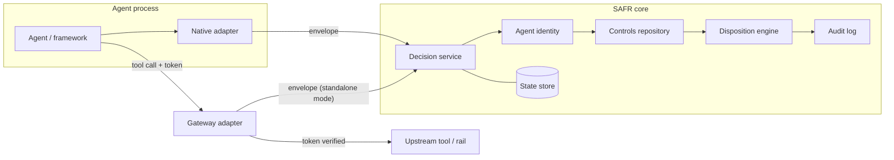
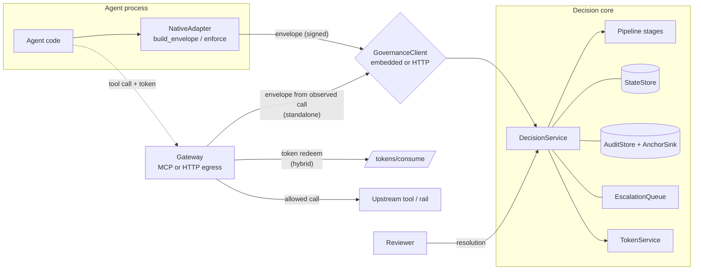
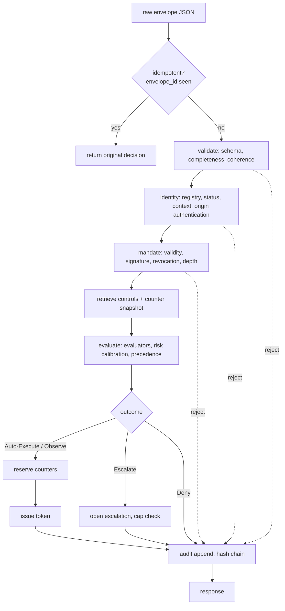
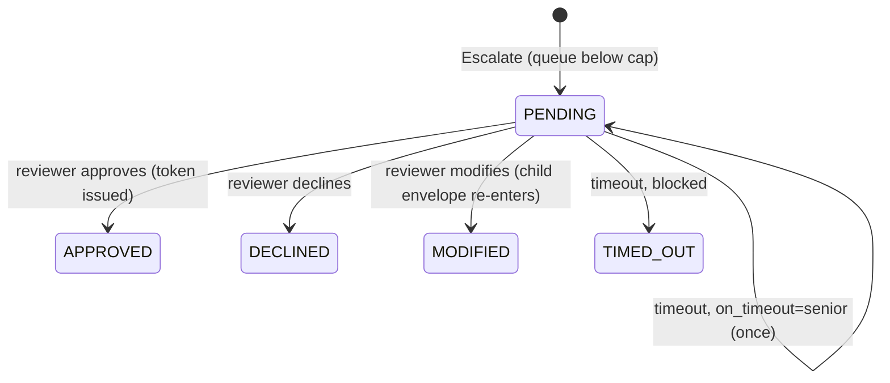

# Architecture

> Unofficial reference implementation based on the SAFR white paper. Not regulatory guidance.

## Architecture

**Principle:** one decision core, several enforcement points. Native and gateway differ only in where the envelope is built and where the outcome is enforced.

| Layer | Contents | Runs as |
|---|---|---|
| `arg.core` | Models, canonicalisation, crypto, identity, controls, engine, audit, escalation, tokens, store/registry/sink interfaces | Library, no web or cloud dependencies |
| `arg.service` | Decision API (FastAPI), config, telemetry | Container; serverless-compatible |
| `arg.adapters.*` | Native hooks: embedded mode (in-process core) or HTTP mode | In the agent process |
| `arg.gateway.*` | MCP gateway and HTTP egress gateway | Separate stateless process |
| `demo/` | Example Bank mock rails, scripted agents, scenario runner | Local and CI |

**Tradeoff to document:** a gateway sees the real call (authentic action, credential-derived identity) but not the reasoning, so the trace is thin. Native sees a rich trace but it is agent-declared. Hybrid mode (INT-04) combines them.

**Gateway modes**
- **Standalone:** gateway builds the envelope from the observed call and decides. Satisfies INT-02 alone.
- **Hybrid:** gateway requires a valid decision token whose action hash matches the observed call, then forwards. Bypass of native instrumentation is blocked.

**Escalation is asynchronous.** `Escalate` returns `pending` with an `escalation_id`; connections are never held open. Reviewer approval issues a token; the agent retries with it. A sweeper (callable by a scheduled function) applies the timeout default: block, or reassign to a senior reviewer.

**State:** the core is stateless; all state (exposure/rate counters, escalations, consumed token IDs, audit streams) sits behind interfaces. Implementations: in-memory, SQLite (local), and Postgres (portable networked store). A shared contract test suite runs against every implementation.

**Telemetry:** OpenTelemetry spans per pipeline stage, metrics (decisions by outcome, stage latency, escalation queue depth). For the envelope's action trace, map to the OpenTelemetry GenAI conventions (`invoke_agent`, `execute_tool`). Check their current status and pin a version; at time of writing they were reported as "Development".

---

## As built

The diagrams below are original to this repository (Mermaid) and describe the implementation
as it stands, which differs from the plan in a few places (noted under each).

### Components and integration patterns

### Decision pipeline

Every rejection and every outcome ends in the audit append (AUD-01). Any exception anywhere
becomes Deny (INT-05); if the append itself fails after reserving, the reservation is
released (SG-04).

### Escalation states

Differences from the plan: audit is performed by `DecisionService` on every path rather than
as a configurable last stage (ADR-0014); a `mandate` stage was added; framework adapters are a
docking point (`docs/adapters/README.md`) rather than shipped implementations.
